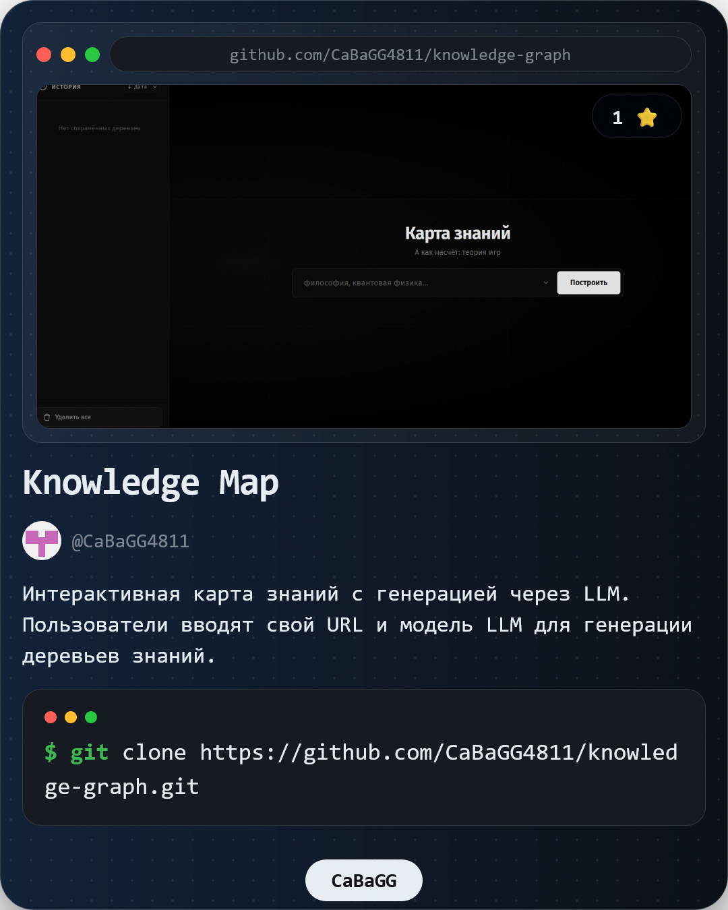

<div align="center">



# Knowledge Graph

**Интерактивные деревья знаний на основе больших языковых моделей.**

Локальное приложение: интерфейс и данные остаются на вашем компьютере,
запросы отправляются только выбранному провайдеру ИИ.


</div>

---

## Возможности

- Генерация дерева знаний по теме: от базовых понятий к продвинутым разделам.
- Интерактивный граф на D3.js: масштабирование, панорамирование, подсветка связей.
- Карточки тем с описанием, сложностью, временем изучения и зависимостями.
- Тесты и конспекты, создаваемые по запросу.
- Раздел «Моё творчество»: сохранённые карточки и деревья.
- Централизованный поиск по деревьям и карточкам.
- 25+ провайдеров ИИ, включая локальные и облачные решения.
- Подключение собственного OpenAI-совместимого или Anthropic API.
- Четыре темы интерфейса и регулируемый размер шрифта.
- Шесть языков интерфейса: русский, английский, китайский, испанский, хинди, арабский.

## Стек

| Слой | Технологии |
|---|---|
| Frontend | Vanilla JavaScript, CSS, D3.js |
| Backend | Node.js 18+, Express 5 |
| Storage | SQLite через sql.js |
| AI | OpenAI-compatible и Anthropic API |

## Быстрый старт

Требуется [Node.js](https://nodejs.org) версии 18 или новее.

```bash
git clone <repository-url>
cd knowledge-graph

cd server
npm install
npm start
```

Откройте **http://localhost:3000**.

При первом запуске база данных создаётся автоматически в `server/knowledge-graph.db`.

## Подключение ИИ

Откройте **Настройки → Провайдеры**.

1. Выберите провайдера из списка или нажмите **«Все провайдеры»**, чтобы увидеть полный каталог.
2. Укажите API-ключ. Ссылка **«Где взять ключ»** ведёт в кабинет провайдера.
3. Выберите модель или загрузите список доступных моделей.
4. Нажмите **«Проверить»**, затем **«Сохранить и использовать»**.

Провайдер можно выбрать из каталога или настроить вручную: название, Base URL,
формат API, модель и заголовок авторизации.

### Поддерживаемые провайдеры

| Облачные | Локальные |
|---|---|
| OpenAI, Anthropic Claude, Google Gemini | LM Studio |
| OpenRouter, Groq, Mistral AI, DeepSeek | Ollama |
| xAI Grok, Together AI, Fireworks AI | llama.cpp, vLLM |
| Perplexity, Cohere, Cerebras, SambaNova | Jan, LiteLLM Proxy |
| NVIDIA NIM, DeepInfra, Hyperbolic | |
| GitHub Models, Azure OpenAI | |

Для локальных моделей API-ключ не требуется.

### Свой провайдер

Выберите **«Свой провайдер»** и укажите:

- **Base URL** — например, `https://api.example.com/v1`;
- **Формат API** — OpenAI-совместимый или Anthropic;
- **Заголовок ключа** — `Authorization: Bearer`, `x-api-key` или `api-key`;
- **Модель** — идентификатор модели у провайдера.

Подойдёт любой сервис с OpenAI-совместимым API, включая корпоративные шлюзы и прокси.

## Безопасность

- API-ключи хранятся только в локальной базе `server/knowledge-graph.db`.
- В ответах API ключи маскируются.
- Сервер принимает запросы только со своего origin и localhost.
- Телеметрия и внешние аккаунты отсутствуют.
- Запрос к модели уходит только выбранному провайдеру.

Перед публикацией в открытый доступ не добавляйте в репозиторий файл `.env`
и локальную базу данных — они исключены через `.gitignore`.

## Настройки

| Параметр | Значения |
|---|---|
| Тема | Тёмная, светлая, ночная, песочная |
| Размер шрифта | Маленький, средний, большой |
| Язык | RU, EN, ZH, ES, HI, AR |

## Структура проекта

```text
knowledge-graph/
├── client/
│   ├── index.html
│   ├── styles/
│   │   ├── themes/          # dark, light, midnight, sand
│   │   └── main.css
│   ├── vendor/              # D3.js (локальная копия)
│   └── scripts/
│       ├── pages/           # home, settings, providers
│       ├── graph.js         # рендер графа
│       ├── modal.js         # карточки, тесты, конспекты
│       ├── router.js
│       ├── api.js
│       └── i18n.js
├── server/
│   ├── server.js
│   ├── db.js
│   ├── llm.js               # провайдеры и вызов моделей
│   └── routes/
│       ├── generate.js
│       ├── providers.js
│       ├── trees.js
│       ├── cards.js
│       └── settings.js
├── docs/
├── LICENSE
└── README.md
```

## Решение проблем

### Порт 3000 занят

```powershell
netstat -ano | findstr :3000
taskkill /PID <PID> /F
```

Или запустите на другом порту:

```powershell
$env:PORT = 3001; npm start
```

### Ошибка подключения к провайдеру

Откройте **Настройки → Провайдеры** и нажмите **«Проверить»**.

| Код | Причина |
|---|---|
| 401, 403 | Неверный или просроченный API-ключ |
| 404 | Не найдена модель или эндпоинт |
| 429 | Превышен лимит запросов |
| Таймаут | Локальный сервер не запущен или модель загружается |

Для локальных моделей проверьте, что LM Studio, Ollama или другой сервер запущен,
а нужная модель загружена.

### Некорректный JSON от модели

Небольшие локальные модели не всегда соблюдают формат ответа.
Используйте модель большего размера или облачного провайдера.

### Открылась старая версия интерфейса

Обновите страницу с очисткой кеша: `Ctrl + Shift + R`.

## Лицензия

Проект распространяется по лицензии [MIT](LICENSE).
