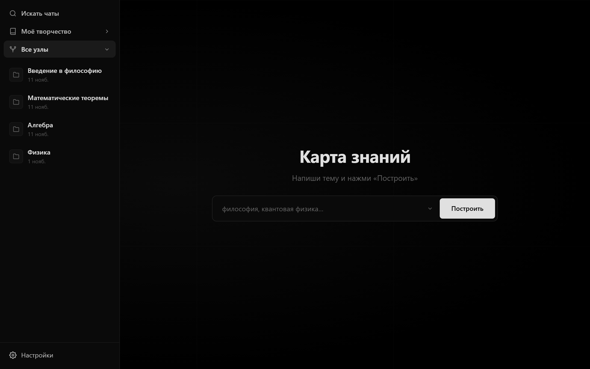
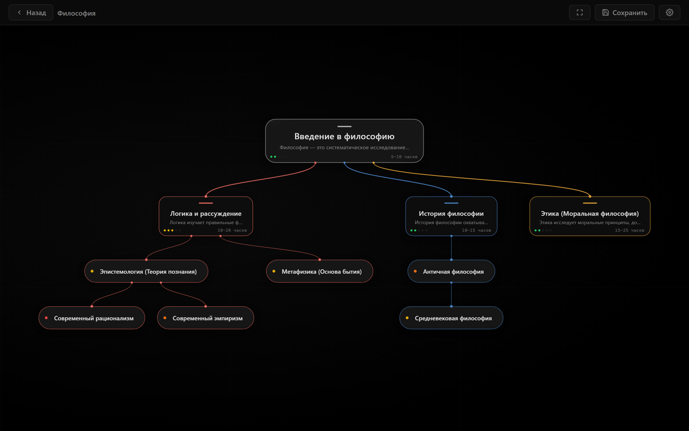
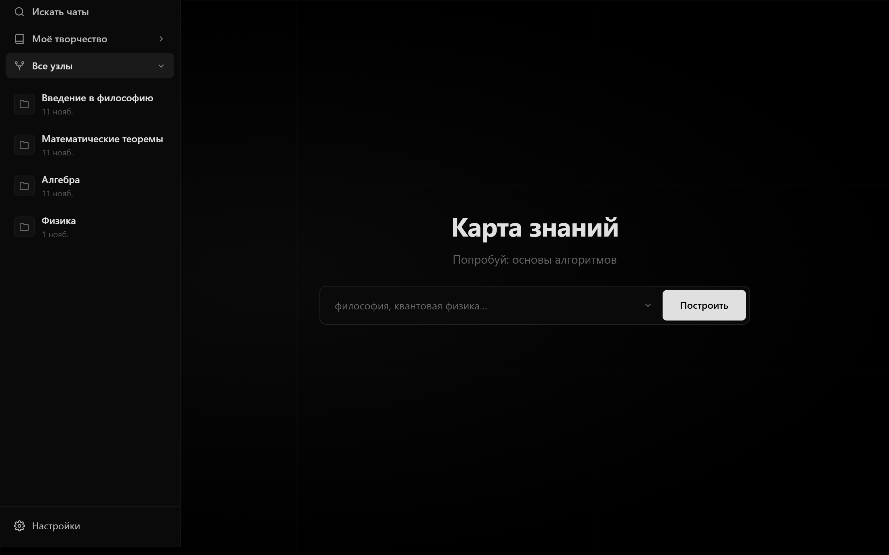
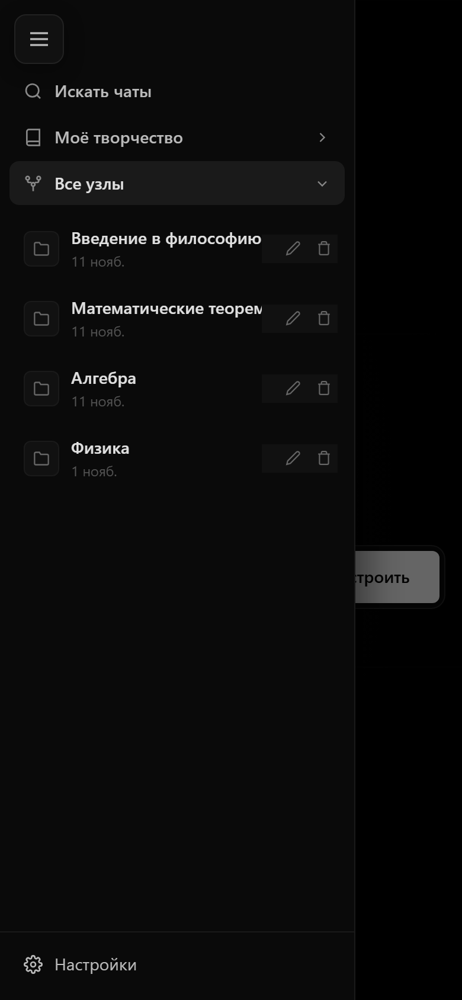

# 🗺️ Карта знаний

**Образовательный сайт, который превращает любую тему в наглядное интерактивное дерево знаний.**

Вводишь тему — «квантовая физика», «фотосинтез», «история Древнего Рима» — и получаешь карту: карточки-понятия с объяснением, сложностью и временем изучения, связанные связями «что на чём строится». Видно весь маршрут: с чего начать и куда это ведёт.

## 🌐 Бета-версия онлайн

**[karta-znaniy.onrender.com](https://karta-znaniy.onrender.com)** — живая версия на бесплатном Render.

> Первый заход после простоя может занять до минуты — сервис «просыпается».

<p align="center">
  
  &nbsp;
  
</p>
<p align="center">
  
  &nbsp;
  
</p>

## ✨ Возможности

- 🧠 **Дерево знаний по любой теме** — описания понятий, сложность по шкале 1–5, примерное время на изучение
- 🔗 **Связи между понятиями** — видно, что учить сначала и куда ветка ведёт дальше
- 📚 **Библиотека** — сохранение карт, переименование, удаление, «Моё творчество» для своих материалов
- 📱 **Адаптивный интерфейс** — работает на компьютере и на телефоне (вертикальный экран)
- 🌍 **7 языков интерфейса** — русский, белорусский, английский, 中文, español, हिन्दी, العربية
- 🎨 **4 темы оформления** — тёмная, светлая, ночная, песочная
- 🛡️ **Проверка запросов** перед генерацией

## 💡 Честно про ИИ

> **Сайт — это оболочка («пульт управления»), а не источник ИИ.** Внутри сайта нет нейросети: карты строит та модель, которую вы подключаете сами. Два варианта:

| | 🏠 Локальная модель | ☁️ Облачный сервис по ключу |
|---|---|---|
| **Цена** | Бесплатно | Обычно платно — по факту использования |
| **Где работает** | На вашем компьютере | В интернете, у сторонней компании |
| **Нужен мощный ПК** | Желательно | Нет |
| **Настройка** | Установить [LM Studio](https://lmstudio.ai), скачать модель, запустить сервер | Получить API-ключ в личном кабинете провайдера |
| **Приватность** | Максимум — всё остаётся на ПК | Запросы уходят выбранному провайдеру |

- **Локально (рекомендуется для старта):** ставите бесплатную LM Studio → скачиваете модель → «Developer» → запускаете сервер (порт 1234) → в настройках сайта выбираете LM Studio. Подробные шаги — на экране настроек сайта.
- **Облако:** подходит OpenAI (GPT), Anthropic (Claude), Google Gemini и любые OpenAI-совместимые API. Ключ хранится только в локальной базе на вашем компьютере и отправляется лишь выбранному провайдеру.

## 🚀 Быстрый старт локально

```bash
git clone https://github.com/CaBaGG4811/knowledge-graph.git
cd knowledge-graph
npm install --prefix server
node server/server.js
```

Откройте `http://localhost:3000`, затем в **Настройках** подключите ИИ-провайдера (см. раздел выше). Без подключённой модели сайт откроется, но генерация карт работать не будет — так и задумано.

## ☁️ Деплой на бесплатный хостинг

Кнопка развернёт сайт на [Render](https://render.com) (бесплатный план, нужен аккаунт GitHub):

[](https://render.com/deploy?repo=https://github.com/CaBaGG4811/knowledge-graph)

Или вручную: «New → Web Service» → подключите этот репозиторий → Render подхватит `render.yaml` (build: `npm install --prefix server`, start: `node server/server.js`).

**Важно:** на хостинге локальная модель вашего ПК недоступна — подключите облачного провайдера по ключу в настройках развёрнутого сайта. На бесплатном плане Render база данных сбрасывается при перезапуске сервиса.

## 🗂️ Структура проекта

```
├── client/            # фронтенд: SPA без сборки (vanilla JS + D3.js)
│   ├── scripts/       # страницы, роутер, i18n (7 языков), модалки
│   ├── styles/        # main.css + 4 темы на CSS-переменных
│   └── vendor/        # d3.v7
└── server/            # бэкенд: Node.js + Express 5
    ├── routes/        # trees, generate, providers, settings, cards
    ├── db.js          # SQLite (sql.js, без нативных модулей)
    └── llm.js         # универсальный клиент провайдеров (OpenAI/Anthropic/LM Studio)
```

## 🛠️ Стек

`Node.js 18+` · `Express 5` · `sql.js (SQLite)` · `D3.js v7` · vanilla JS — без сборки и фреймворков

## 📄 Лицензия

MIT — см. [LICENSE](LICENSE)
